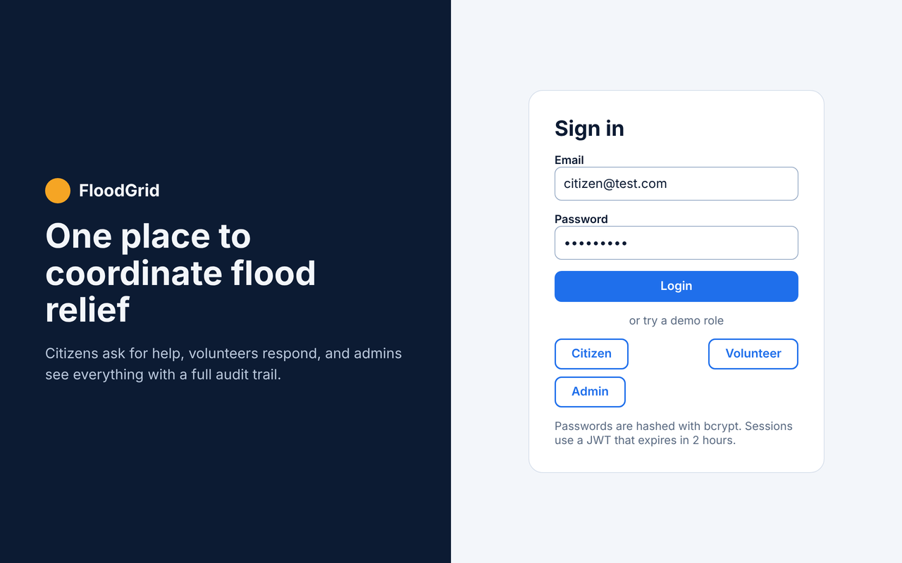
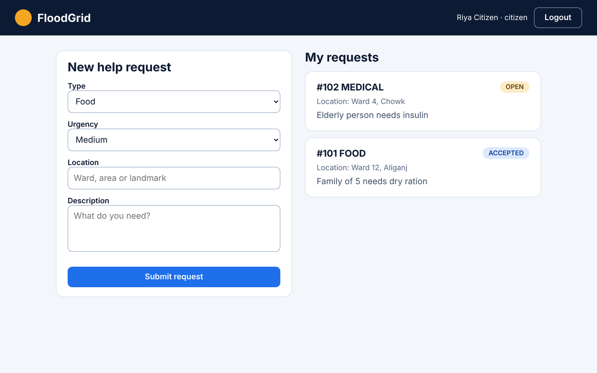
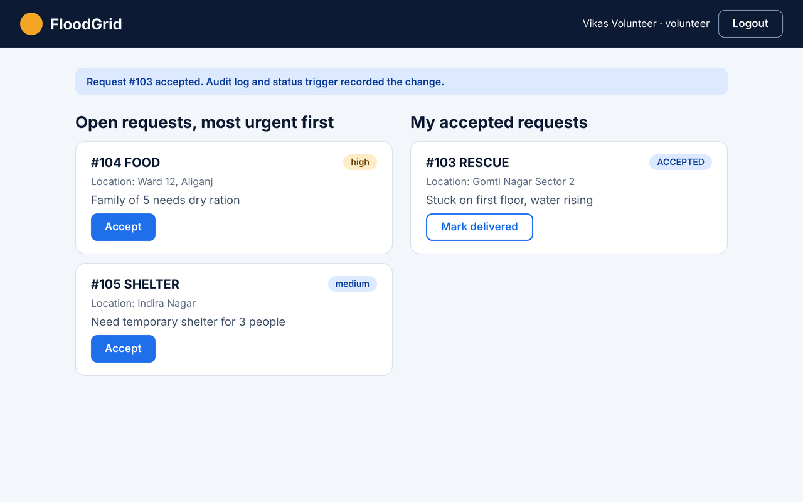
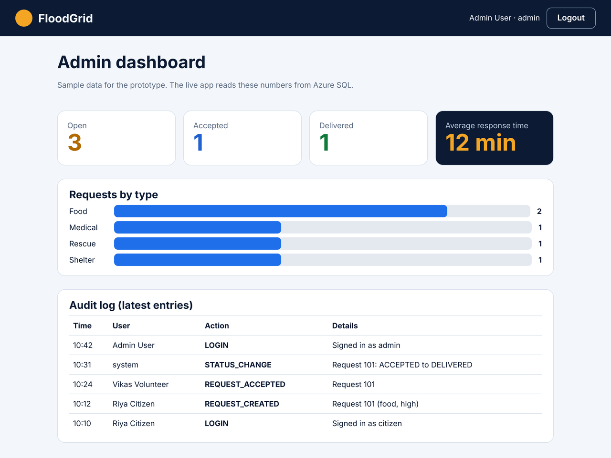
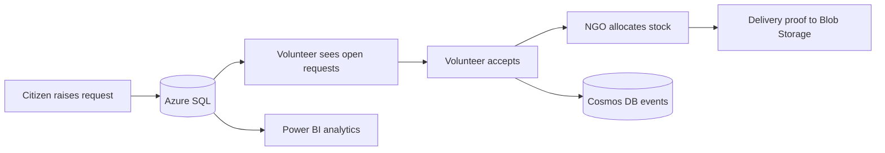
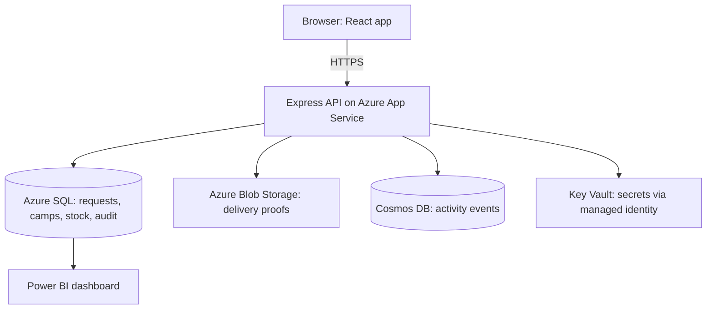
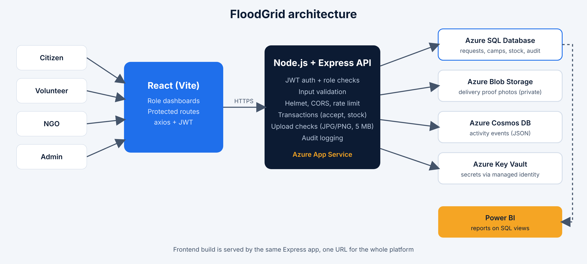
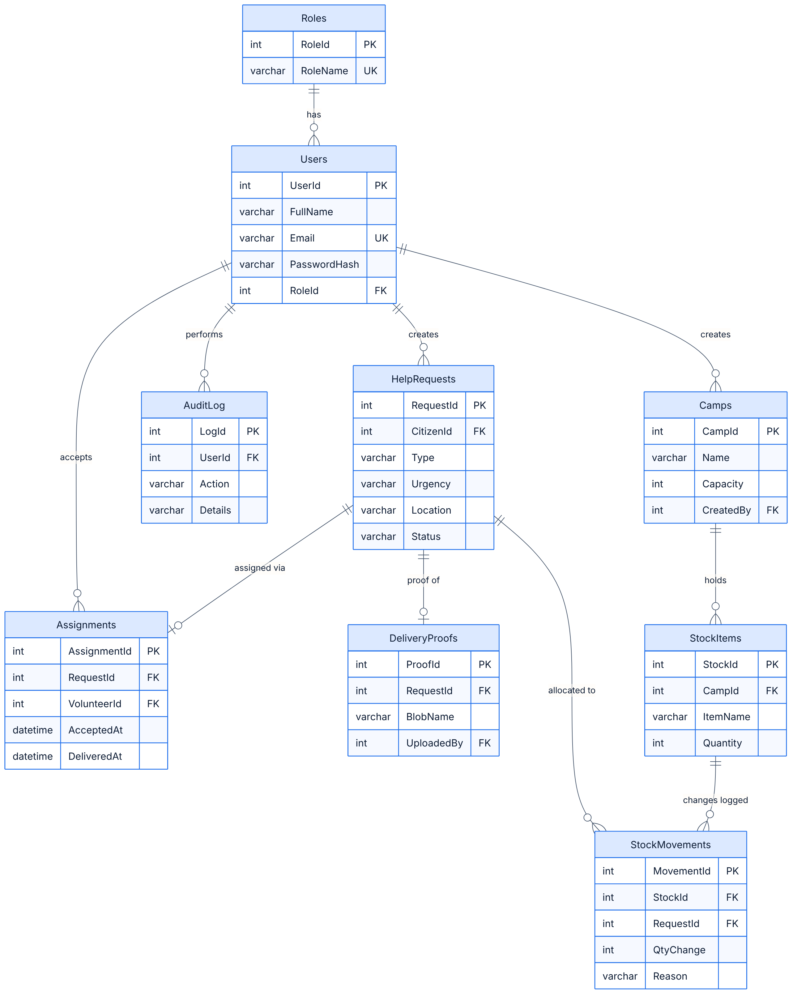

<div align="center">

# 🌊 FloodGrid
### Secure Disaster Relief Coordination Platform

*One system. No missed requests. Full accountability.*

[](https://flood-grid.onrender.com/)


[Live Demo](#-live-demo) · [Overview](#overview) · [Features](#features) · [Architecture](#architecture) · [Quick Start](#quick-start) · [API](#api) · [Security](#security) · [Roadmap](#roadmap)

</div>

---

## 🌐 Live Demo

**Prototype:** https://flood-grid.onrender.com/

Log in with any of these dummy accounts (password for all: `Test@1234`):

| Role | Email |
|---|---|
| Citizen | `citizen@test.com` |
| Volunteer | `volunteer@test.com` |
| Admin | `admin@test.com` |

> **Note:** The demo runs on free hosting. If nobody has opened it for a while, the first load can take about a minute. Demo data resets whenever the server restarts.

**Try this:** raise a request as a Citizen, then open a second tab as Volunteer. The request appears there instantly (live updates).

---

## 📸 Screenshots

Clickable UI design of the platform (sample data). Open it yourself: [`prototype/ui-mock/FloodGrid_Prototype.html`](prototype/ui-mock/FloodGrid_Prototype.html).

| Login | Citizen dashboard |
|---|---|
|  |  |

| Volunteer dashboard | Admin dashboard |
|---|---|
|  |  |

---

## Overview
FloodGrid is a web platform that coordinates flood relief. Affected citizens raise help requests, volunteers accept and fulfil them, NGOs manage camps and stock, and every action is stored in a database with an audit trail.

Built as an integrated full-stack project covering **System Design, RDBMS, DP-900 and Cloud Security**.

### The Problem
During floods, relief runs on scattered WhatsApp messages and phone calls. This causes:
- Missed or duplicate requests
- Wrongly allocated stock
- No accountability

FloodGrid brings everything into one secure system.

### Two versions in this repo
| | Prototype | Main project |
|---|---|---|
| **Folder** | [`prototype/`](prototype/) | `frontend/`, `backend/`, `database/` |
| **Stack** | Node.js 22, SQLite, plain HTML/JS, three.js | React, Express, Azure SQL, Blob, Cosmos DB |
| **Status** | ✅ Working and deployed (Live Demo above) | 🚧 In progress, Azure deployment pending |
| **Highlights** | Cinematic 3D flood intro, live dashboards, zero dependencies | NGO camps and stock, delivery proof photos, activity events, Power BI |

---

## Roles
| Role | What they do |
|---|---|
| **Citizen** | Raise help requests and track their status |
| **Volunteer** | View open requests and accept them |
| **NGO** | Create relief camps, add stock, allocate it to requests |
| **Admin** | View analytics, total stock and the audit log |

## Features
- **Role-based access:** each user sees only what their role allows
- **Help request lifecycle:** create, view open requests, accept, deliver, track
- **Camp and stock management:** transactional allocation using the stored procedure `sp_AllocateStock`, so stock never goes out of sync
- **Delivery proof:** photo upload to Azure Blob Storage
- **Activity events:** stored in Cosmos DB (NoSQL, partition key `/userId`)
- **Analytics:** Power BI dashboard on Azure SQL views
- **Audit log:** every user action is recorded
- **Health check:** one endpoint confirms backend and database are connected

## How It Works


## Architecture


## Tech Stack
| Layer | Tech |
|---|---|
| Frontend | React |
| Backend | Node.js, Express |
| Database | Azure SQL (relational) |
| Auth | JWT, bcrypt |
| Security | Helmet, CORS, rate limiting, parameterized queries |
| Azure | SQL Database, App Service, Blob Storage, Cosmos DB, Key Vault, Power BI |

---

## Project Structure
```
Flood_grid/
├── frontend/                  React app (Vite): pages, components, theme
├── backend/                   Express API for the main project
│   ├── routes/                auth, citizen, volunteer, proof, ngo, admin
│   ├── middleware/            JWT auth, role checks, validation
│   ├── utils/                 audit log, Blob helper, Cosmos events
│   ├── public/                Production frontend build
│   └── setup*.js              One-time database setup scripts
├── database/                  schema.sql, schema_camps.sql
├── prototype/                 Working prototype (3D intro UI, Node + SQLite)
│   ├── backend/               Zero-dependency Node server
│   ├── frontend/              HTML, CSS, JS, three.js scene
│   └── ui-mock/               Static clickable UI design
├── docs/                      Design, security and Azure documents
│   └── images/                Screenshots and diagrams
├── README.md
└── .gitignore
```

### Docs
| File | Contents |
|---|---|
| [`architecture.md`](docs/architecture.md) | System architecture |
| [`er-diagram.md`](docs/er-diagram.md) | Database ER diagram |
| [`api-list.md`](docs/api-list.md) | Full API endpoint list |
| [`azure-setup.md`](docs/azure-setup.md) | Azure services setup |
| [`security-checklist.md`](docs/security-checklist.md) | Security checklist |
| [`threat-model.md`](docs/threat-model.md) | Threat model |
| [`data-classification.md`](docs/data-classification.md) | Data classification |
| [`powerbi-guide.md`](docs/powerbi-guide.md) | Power BI dashboard guide |

### Diagrams




---

## Quick Start

First, clone the repo:
```bash
git clone <REPO_LINK>
cd <REPO_FOLDER>
```

### Option A: Run the prototype (easiest)
Needs **Node.js 22.5 or newer**. No `npm install` and no database setup needed.
```bash
cd prototype/backend
npm start          # open http://localhost:3000
npm test           # 5 automated API tests
```
Demo data is created automatically on first start. To reset it, run `npm run seed`.
More details are in [`prototype/README.md`](prototype/README.md).

### Option B: Run the main project (Azure SQL)

<details>
<summary><b>Click to expand the steps</b></summary>

**1. Database**
1. Create an Azure SQL database.
2. In the server firewall settings, allow your IP address.

**2. Backend**
```bash
cd backend
npm install
```
Create `backend/.env` (never commit this file):
```env
DB_SERVER=your-server.database.windows.net
DB_NAME=your-database-name
DB_USER=your-username
DB_PASSWORD=your-password
JWT_SECRET=any-long-random-string
PORT=5000
```

**3. Create tables and test data** (run once, in this order)
```bash
node setupUsers.js    # Roles, Users and the test accounts
node setupDb.js       # tables, view, stored procedure, trigger, sample data
node setupCamps.js    # camps, stock and the NGO test account
node setupProof.js    # DeliveryProofs table (for photo proof)
```
These scripts read `database/schema.sql` and `database/schema_camps.sql` for you.

**4. Start the backend**
```bash
npm start
```
The backend runs on port `5000` by default.

**5. Frontend**
```bash
cd frontend
npm install
npm run dev        # development
npm run build      # production build
```
The build is copied to `backend/public` and served by the Express backend.

> Blob Storage and Cosmos DB switch on through optional environment variables (see `backend/.env.example`). The app still works without them. Full guide: [`docs/azure-setup.md`](docs/azure-setup.md).

</details>

## Test Logins (dummy data only)
Password for all accounts: `Test@1234`

| Role | Email | Prototype | Main project |
|---|---|:---:|:---:|
| Citizen | citizen@test.com | ✅ | ✅ |
| Volunteer | volunteer@test.com | ✅ | ✅ |
| Admin | admin@test.com | ✅ | ✅ |
| NGO | ngo@test.com | | ✅ |

---

## API
Main project. Base URL is `/api`. Protected routes need the header `Authorization: Bearer <JWT>`.

| Method | Endpoint | Role | Description |
|---|---|---|---|
| `GET` | `/health` | public | Check backend and database connection |
| `POST` | `/auth/login` | public | Login and receive a token |
| `POST` | `/requests` | citizen | Create a help request |
| `GET` | `/requests/mine` | citizen | Own requests with volunteer name |
| `GET` | `/requests` | volunteer, admin | Open requests, most urgent first |
| `GET` | `/requests/accepted` | volunteer | Requests accepted by me |
| `PUT` | `/requests/:id/accept` | volunteer | Accept a request (stored procedure, transaction) |
| `PUT` | `/requests/:id/deliver` | volunteer | Mark delivered, optional proof photo (JPG/PNG, max 5 MB) |
| `GET` | `/requests/:id/proof` | admin, ngo, owner, assigned volunteer | View delivery proof photo |
| `GET` | `/ngo/camps` | ngo, admin | Camps with their stock |
| `GET` | `/ngo/requests` | ngo, admin | Requests that can receive relief |
| `POST` | `/ngo/camps` | ngo | Create a camp |
| `POST` | `/ngo/stock` | ngo | Add stock to a camp (transaction) |
| `POST` | `/ngo/allocate` | ngo | Allocate stock to a request (`sp_AllocateStock`) |
| `GET` | `/admin/stats` | admin | Counts by status and type, average response time |
| `GET` | `/admin/stock` | admin | Total stock per item across camps |
| `GET` | `/admin/audit` | admin | Latest 50 audit log entries |

---

## Security
| Area | Measure |
|---|---|
| Authentication | bcrypt hashing, JWT tokens |
| Authorization | Role-based access control on routes |
| Data | Parameterized SQL queries, input validation |
| Web | Helmet headers, CORS configuration |
| Abuse | Rate limiting on login attempts |
| Secrets | `.env` is gitignored, Key Vault with managed identity in the cloud |
| Network | Azure SQL firewall, HTTPS only, least privilege |
| Accountability | Audit log of user actions |

Details: [`docs/security-checklist.md`](docs/security-checklist.md) and [`docs/threat-model.md`](docs/threat-model.md).

## Roadmap
- [x] Role-based login
- [x] Help request create and accept flow
- [x] Azure SQL integration
- [x] Frontend build served by backend
- [x] Camp and stock management
- [x] Blob, Cosmos DB, Key Vault integration in code
- [x] Prototype deployed online (Live Demo)
- [ ] End-to-end testing
- [ ] Azure App Service deployment and configuration
- [ ] Final integration and cloud security configuration

---

## Team
| Name | Roll No. |
|---|---|
| Ananya Srivastava | 25LBCS3220 |
| Kavya Kushwaha | 25LBCS3217 |

## Credits
React, Express, mssql, bcrypt, jsonwebtoken.
AI tools were used as an aid for planning and drafting, and all code is understood and explainable by the team.
