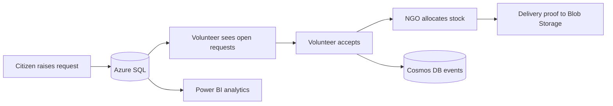
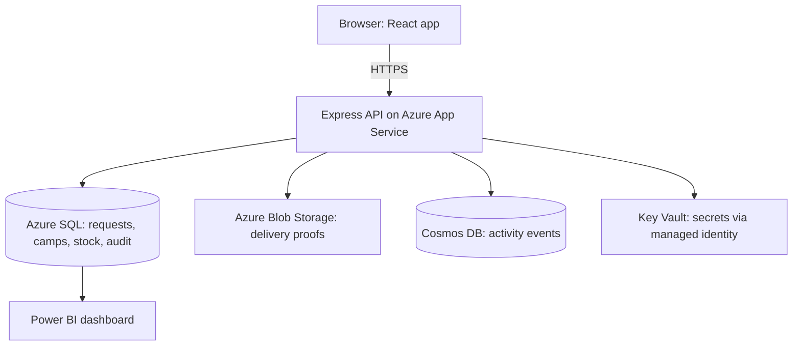

<div align="center">

# 🌊 FloodGrid
### Secure Disaster Relief Coordination Platform

*One system. No missed requests. Full accountability.*


[Overview](#overview) · [Features](#features) · [Architecture](#architecture) · [Quick Start](#quick-start) · [API](#api) · [Security](#security) · [Roadmap](#roadmap)

</div>

---

## Overview
FloodGrid is a web platform that coordinates flood relief. Affected citizens raise help requests, volunteers accept and fulfil them, NGOs manage camps and stock, and every action is stored in a database with an audit trail.

Built as an integrated full-stack project covering **System Design, RDBMS, DP-900 and Cloud Security**.

### The Problem
During floods, relief runs on scattered WhatsApp messages and phone calls. This causes:
- Missed or duplicate requests
- Wrongly allocated stock
- No accountability

FloodGrid brings everything into one secure system.

## Roles
| Role | What they do |
|---|---|
| **Citizen** | Raise help requests and track their status |
| **Volunteer** | View open requests and accept them |
| **NGO** | Create relief camps, add stock, allocate it to requests |
| **Admin** | View analytics, total stock and the audit log |

## Features
- **Role-based access:** each user sees only what their role allows
- **Help request lifecycle:** create, view open requests, accept, track
- **Camp and stock management:** transactional allocation using the stored procedure `sp_AllocateStock`, so stock never goes out of sync
- **Delivery proof:** photo upload to Azure Blob Storage
- **Activity events:** stored in Cosmos DB (NoSQL, partition key `/userId`)
- **Analytics:** Power BI dashboard on Azure SQL views
- **Audit log:** every user action is recorded
- **Health check:** one endpoint confirms backend and database are connected

## How It Works


## Architecture


## Tech Stack
| Layer | Tech |
|---|---|
| Frontend | React |
| Backend | Node.js, Express |
| Database | Azure SQL (relational) |
| Auth | JWT, bcrypt |
| Security | Helmet, CORS, rate limiting, parameterized queries |
| Azure | SQL Database, App Service, Blob Storage, Cosmos DB, Key Vault, Power BI |

## Project Structure
```
frontend/        React app
backend/         Express API and server
backend/public/  Production frontend build
database/        schema.sql, schema_camps.sql, sample data
docs/            architecture, API list, security and Azure guides
README.md
```

## Quick Start

### 1. Clone
```bash
git clone <REPO_LINK>
cd <REPO_FOLDER>
```

### 2. Database
1. Create an Azure SQL database.
2. In the server firewall settings, allow your IP address.
3. Run `database/schema.sql` and `database/schema_camps.sql`, then the sample data script.

### 3. Backend
```bash
cd backend
npm install
```
Create `backend/.env` (never commit this file):
```env
DB_SERVER=your-server.database.windows.net
DB_NAME=your-database-name
DB_USER=your-username
DB_PASSWORD=your-password
JWT_SECRET=any-long-random-string
PORT=5000
```
```bash
npm start
```
The backend runs on port `5000` by default.

> Blob Storage, Cosmos DB and Key Vault switch on through environment variables. See `docs/azure-setup.md`.

### 4. Frontend
```bash
cd frontend
npm install
npm run dev        # development
npm run build      # production build
```
The build is copied to `backend/public` and served by the Express backend.

## Test Logins (dummy data only)
| Role | Email | Password |
|---|---|---|
| Citizen | citizen@test.com | Test@1234 |
| Volunteer | volunteer@test.com | Test@1234 |
| Admin | admin@test.com | Test@1234 |

## API
| Method | Endpoint | Description |
|---|---|---|
| `POST` | `/api/auth/login` | Login and receive a token |
| `POST` | `/api/requests` | Citizen creates a help request |
| `GET` | `/api/requests` | List open requests |
| `PUT` | `/api/requests/:id/accept` | Volunteer accepts a request |
| `GET` | `/api/health` | Check backend and database connection |

Full endpoint list (camps, stock, uploads) is in `docs/`.

## Security
| Area | Measure |
|---|---|
| Authentication | bcrypt hashing, JWT tokens |
| Authorization | Role-based access control on routes |
| Data | Parameterized SQL queries, input validation |
| Web | Helmet headers, CORS configuration |
| Abuse | Rate limiting on login attempts |
| Secrets | `.env` is gitignored, Key Vault with managed identity in the cloud |
| Network | Azure SQL firewall, HTTPS only, least privilege |
| Accountability | Audit log of user actions |

## Roadmap
- [x] Role-based login
- [x] Help request create and accept flow
- [x] Azure SQL integration
- [x] Frontend build served by backend
- [x] Camp and stock management
- [x] Blob, Cosmos DB, Key Vault integration in code
- [ ] End-to-end testing
- [ ] Azure App Service deployment and configuration
- [ ] Final integration and cloud security configuration

## Team
| Name | Roll No. |
|---|---|
| Ananya Srivastava | 25LBCS3220 |
| Kavya Kushwaha | 25LBCS3217 |

## Credits
React, Express, mssql, bcrypt, jsonwebtoken.
AI tools were used as an aid for planning and drafting, and all code is understood and explainable by the team.
