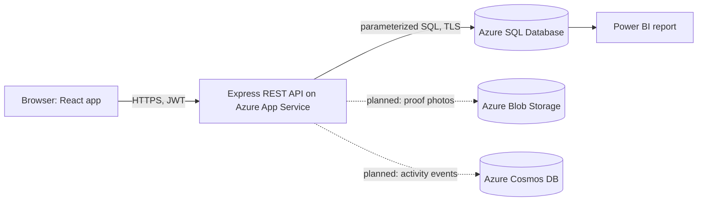

# Architecture and Design

## Requirements
**Functional:** login with roles; citizens create and track help requests; volunteers see open requests by urgency, accept and mark delivered; admins see analytics and the audit log.
**Non-functional:** security (hashed passwords, JWT, RBAC), consistency (no double acceptance), auditability, availability on Azure, response under 1 second for list calls.

## High-level architecture

**Data flow:** the browser logs in and gets a JWT. Each API call carries the token. The API checks the role, runs a parameterized query or stored procedure on Azure SQL, writes an audit entry and returns JSON.

## API list
See `docs/api-list.md`.

## Trade-off (written)
**Caching vs freshness:** during a flood many volunteers refresh the open-requests list. Caching it (for example 10 seconds in Redis) would reduce database load, but a volunteer could see a request that was just accepted. We chose no cache for now and rely on the accept procedure returning 409 for stale requests; caching is the first scaling step if traffic grows.
**Monolith vs services:** one Express app is simpler to deploy and debug for a two-member team. Splitting into request, user and audit services would help scale independently but adds network and deployment overhead.
