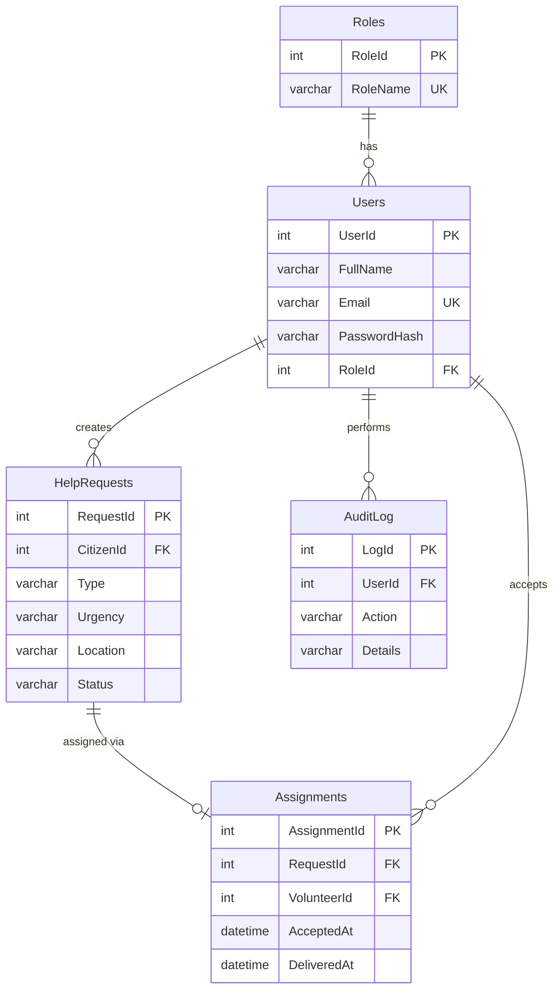

# ER Diagram

**Normalization (3NF):** every table has a single primary key and each non-key column depends only on that key. Role names live in `Roles`, not in `Users`. The volunteer for a request lives in `Assignments`, not in `HelpRequests`.

**Constraints:** foreign keys on all relations, CHECK on `Type`, `Urgency`, `Status`, UNIQUE on `Users.Email` and `Assignments.RequestId`.
**Indexes:** `IX_HelpRequests_Status`, `IX_HelpRequests_Citizen`.
**View:** `vw_OpenRequests`. **Stored procedure with transaction:** `sp_AcceptRequest`. **Trigger:** `trg_RequestStatusAudit`.
